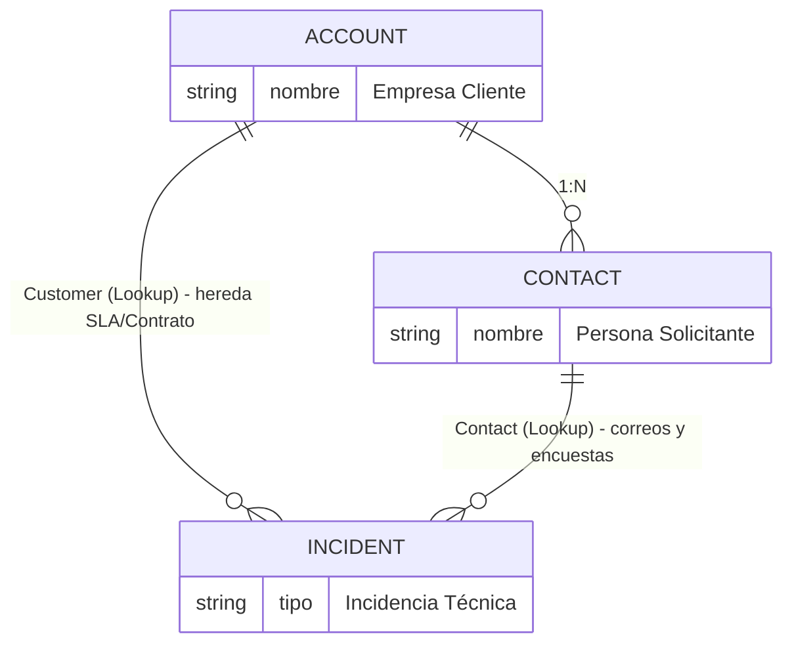

# Proyecto Piloto: CG_SupportHub — Fase 1: Configuración Inicial (Seguridad y Datos Maestros)

## 📌 Metadatos del Entorno y Proyecto
- **Entorno:** `3618-gameofcodes.crm4.dynamics.com`
- **Environment ID:** `8a0ffac2-dba7-eea5-afca-3f1f46b9661d`
- **Solución Principal:** `CG_SupportHub`
- **Prefijo del Editor (Publisher):** `cg_`
- **Empresa:** CG_TechSolutions (Soporte B2B de Hardware y Software)

---

## 1. Fundamento Arquitectónico y Modelo Relacional B2B

Para el modelo de soporte corporativo (*B2B*), se definió la separación clara de responsabilidades entre entidades maestras:

    - **Cuenta (`Account`):** Representa a la empresa contratante. Contiene las condiciones contractuales del servicio (Segmento y Nivel de SLA).
- **Contacto (`Contact`):** Representa al empleado corporativo que reporta la incidencia y recibe la comunicación operativa.
- **Caso (`Incident`):** Registro transaccional donde convergen el cliente contractual y el solicitante.

---

## 2. Componentes y Personalizaciones de Datos Maestros

### Tablas incorporadas a la solución `CG_SupportHub`
- `Account` (Cuenta)
- `Contact` (Contacto)

### Columnas y Atributos de Clasificación
Para la clasificación de clientes en la tabla `Account`, se establecieron las siguientes opciones de negocio:

| Concepto de Negocio | Nombre Lógico / Esquema | Tipo | Valores / Opciones |
| :--- | :--- | :--- | :--- |
| **Segmento de Cliente** | `cg_segmentocliente` *(o `businesstypecode`)* | Choice (Opción) | • Enterprise • SMB (Pequeña y Mediana Empresa) |
| **Nivel de Soporte Contratado** | `cg_nivelsoporte` *(o `customertypecode`)* | Choice (Opción) | • Oro • Plata • Bronce |

> **Nota Técnica de Implementación:**  
> En este entorno de laboratorio, se parametrizaron las opciones directamente sobre los campos estándar correspondientes (`businesstypecode` y `customertypecode`), manteniendo compatibilidad funcional para la posterior lectura en SLAs y Power Automate.

---

## 3. Modelo de Seguridad y Roles

Para garantizar el principio de mínimo privilegio y evitar la pérdida de dependencias nativas del servicio de Customer Service, se crearon roles por clonación en lugar de construcción desde cero:

| Nuevo Rol de Seguridad | Rol Base de Clonación | Ámbito de Privilegio Sugerido | Propósito Operativo |
| :--- | :--- | :--- | :--- |
| **`CG_AgenteN1`** | Customer Service Representative | Usuario / Unidad de Negocio | Triaje inicial, recepción y resolución de incidencias estándar. |
| **`CG_AgenteN2`** | Customer Service Representative | Unidad de Negocio / Parent BU | Atención de casos escalados, complejidad técnica y reasignación. |
| **`CG_Supervisor`** | Customer Service Manager | Organización / Parent-Child BU | Supervisión general de colas, aprobación, gestión de SLAs y KPIs. |

---

## 4. Diagnóstico de Gobernanza y Permisos en Maker Portal

Durante el despliegue en el sandbox compartido, se documentó la resolución de alertas de permisos en el Maker Portal (`make.powerapps.com`):

- **Síntoma:** Banner de advertencia *"Uno o más comandos no están disponibles debido a sus privilegios actuales para este entorno"*.
- **Causas y Mitigaciones:**
  1. **Rol Environment Maker:** Todo usuario administrador que diseñe en `make.powerapps.com` requiere además los roles de Dataverse `Environment Maker` (Creador de entorno) y `Basic User` (Usuario básico).
  2. **Licenciamiento M365:** El usuario debe contar con un plan de servicio o licencia de Power Apps / Dynamics 365 activo en el Microsoft 365 Admin Center para salir del modo de sólo lectura en el diseñador.
  3. **Contexto de Solución:** Las personalizaciones deben ejecutarse dentro de la solución `CG_SupportHub` para evitar restricciones de edición fuera del ámbito del publisher.

---

## 5. Estado de la Fase y Siguiente Hito

- [x] Solución `CG_SupportHub` creada y vinculada al entorno.
- [x] Estructura de Cuenta y Contacto definida con campos de Segmento y Nivel de Soporte.
- [x] Definición y clonación de roles de seguridad (`CG_AgenteN1`, `CG_AgenteN2`, `CG_Supervisor`).
- [ ] **Próximo Paso — Fase 2:** Configuración de Colas (`CG_ColaN1`, `CG_ColaN2`), canal Email-to-Case y ciclo de vida del Caso (`Incident`).